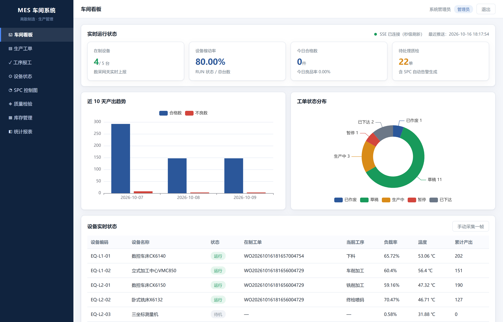
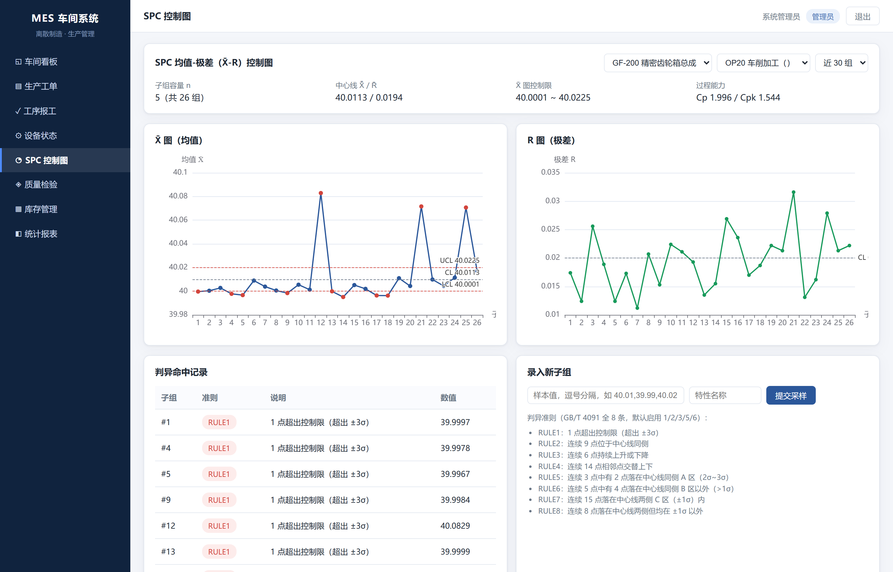

# 离散制造车间生产管理系统（MES 方向）

我一个人写的 MES，场景是离散制造车间。工单派下去、工人报工、设备状态自动采、质量数据超出控制限自动开质检单、报工同时把料扣掉——这条链路是完整跑通的，不是画在纸上的。

技术栈：Python · FastAPI · MySQL · Redis · Vue3 · ECharts · Docker Compose

[](https://www.python.org/)
[](https://fastapi.tiangolo.com/)
[](https://vuejs.org/)
[](./LICENSE)





---

## 目录

* [一、项目背景](#一项目背景)
* [二、功能清单](#二功能清单)
* [三、技术架构与实现方案](#三技术架构与实现方案)
* [四、目录结构](#四目录结构)
* [五、快速开始](#五快速开始)
* [六、测试](#六测试)
* [七、接口文档](#七接口文档)
* [八、演示数据](#八演示数据)
* [九、文档索引](#九文档索引)

---

## 一、项目背景

写这个项目的起因很实际：我想弄明白车间里的账为什么总对不上。

离散制造（多品种、小批量、工艺路线三天两头改）的现场基本是这样——工单靠口头下达、纸质流转，谁改了状态说不清；同一个工人报完工，网络卡了一下又点一次提交，工单数量就翻倍，库存跟着多扣一次。这种脏数据事后极难修，所以我从一开始就把工单状态机和报工幂等当成重点，而不是先堆功能。

设备那边更像黑盒。机器到底在不在跑、稼动率多少，只能事后统计，管理者看到的永远是昨天的数据。数采网关 + Redis + SSE 这一套就是为了让看板变成实时的，不用等人去刷新页面。

质量这块，不少厂子还是靠事后全检，一批做完了才发现问题。SPC 的思路是把控制限画出来，超了立刻报警——这也是我在这个项目里第一次真正接触 SPC，X̄-R 图和那 8 条判异准则是照着 GB/T 4091 一条条实现的，不是调库。

按 MES（Manufacturing Execution System）的常规分层，我把系统拆成 API / Service / Data 三层，业务规则、事务边界、状态机校验统一收在 Service 层，路由层只管参数校验和响应包装。

---

## 二、功能清单

下面是目前实际能跑的功能：

| 模块 | 功能点 |
| --- | --- |
| 生产工单 | 工单创建（按 BOM 展开物料需求）、状态机流转、工序报工、超量拦截、末工序自动完工 |
| 幂等与事务 | 应用层幂等快照 + 数据库唯一约束双层防护，杜绝重复报工 |
| 设备数采 | 模拟网关定时上报运行数据、Redis 缓存实时状态、SSE 秒级推送看板 |
| 质量管理 | SPC X̄-R 控制图（8 条判异准则）、控制限自动重算、异常批次自动生成待处理质检单 |
| 库存管理 | 发料 / 退料 / 盘点、报工自动扣减、库存不足整笔回滚、安全库存预警 |
| 统计报表 | 工单进度、良品率、设备稼动率、产量日报、工序效率、不良柏拉图、库存周转、人员绩效（8 张） |
| 权限控制 | 21 个权限点 / 3 类角色 / 接口级鉴权（管理员、班组长、操作工） |
| 前端看板 | Vue3 + ECharts 九大页面，SSE 实时刷新，按钮按可流转状态动态渲染 |

---

## 三、技术架构与实现方案

### 3.1 分层架构

大概是这样：

```
┌──────────────────────────────────────────────────────────────┐
│  Vue3 + Vite + Pinia + Vue Router + ECharts                  │
│  看板 / 工单 / 报工 / 设备 / SPC / 质检 / 库存 / 报表         │
│            ↑ REST (JWT)              ↑ SSE (text/event-stream)│
├──────────────────────────────────────────────────────────────┤
│  API 层        app/api/v1/*    参数校验 · 权限依赖 · 响应包装 │
│  Service 层    app/services/*  业务规则 · 事务边界 · 状态机   │
│  Data 层       app/models/* + repositories/*  SQLAlchemy ORM  │
├──────────────────────────────────────────────────────────────┤
│  MySQL 8 / SQLite      Redis 7 / 内存降级                     │
│  31 张业务表            设备状态缓存 · 幂等 key · pub/sub      │
└──────────────────────────────────────────────────────────────┘
              ↑ 定时上报（3s）
       模拟设备数采网关 app/realtime/device_gateway.py
```

前端走 REST 拿业务数据，设备推送单独走一条 SSE 长连接。网关每 3 秒上报一帧，先写进 Redis，再由 SSE 广播出去。

### 3.2 几个设计上纠结过的点

**幂等为什么做了两层。**

只靠应用层快照，两个并发请求可能同时通过检查然后双双落库，唯一约束没加就漏了。反过来只靠唯一约束，重复写入是挡住了，但调用方第二次拿不到"首次执行的结果"，只能收到一个报错，前端体验很差。

最后的做法：先查 `sys_idempotency`，命中 `SUCCEEDED` 就直接把上次的响应快照回放回去，命中 `IN_PROGRESS` 返回 409 提示正在处理；没命中才真正跑业务，同时靠 `pp_work_report` 上的 `uk_pp_report_idempotency` 唯一约束兜底。两层互为保险。

**状态机只留一份定义。**

流转表 `WORK_ORDER_TRANSITIONS` 放在模型层。服务层校验读它，`GET /orders/{id}/allowed-transitions` 也读它，前端按钮按这个接口渲染，所以不会出现"按钮能点、后端拒绝"的错位。这里的关键是别在前端再自己维护一份状态列表，不然两边很快就会不同步。

**库存扣减加了行锁。**

`locking.py` 先对 `mm_inventory_stock` 的目标行加锁再判断可用量，避免并发发料超发；不够就抛 `InventoryShortageError` 让整笔事务回滚，不允许出现负库存。

**Redis 连不上就降级。**

`RedisCache` 建连失败时把 `_redis` 置空，切到 `_MemoryBackend`（带过期时间的进程内 KV + pub/sub）。上层代码完全无感，接口语义和用 Redis 时一致。这么做的原因是我想让这个仓库在没有 MySQL、没有 Redis 的机器上也能一键跑起来演示，而不是先教人装环境。

**SPC 算法写成纯函数。**

`spc_core.py` 不碰数据库也不碰框架，输入样本、输出控制限和判异结果。带来的好处很直接：能单独写单测（15 个用例只测算法本身）、能离线试算（`/spc/analyze` 不落库）、换任何工序都能复用。

### 3.3 工单状态机

```
DRAFT ──下达──> RELEASED ──开工──> IN_PROGRESS ──完工──> COMPLETED
  │                │                   │
  └──────取消──────┴───────取消────────┴──────────────> CANCELLED

IN_PROGRESS ──暂停──> PAUSED ──恢复──> IN_PROGRESS
```

### 3.4 一次报工的事务边界

报工是最容易出问题的一步，所以整条流程压在一个事务里：

```
[BEGIN]
  1. 校验工单状态 / 工序状态
  2. 校验累计量 ≤ 计划量                 → 超出：StateConflictError
  3. INSERT pp_work_report（唯一约束兜底）→ 重复：DuplicateReportError
  4. 按 BOM 扣减 mm_inventory_stock（行锁）→ 不足：InventoryShortageError
  5. 写入 qm_spc_subgroup 并执行判异
  6. 命中判异 → INSERT qm_inspection_task(PENDING)
  7. 末工序报满 → 工单自动 IN_PROGRESS → COMPLETED
[COMMIT]  —— 任一步失败则整笔 ROLLBACK
```

---

## 四、目录结构

目录大概长这样：

```
离散制造车间生产管理系统/
├── README.md                      # 本文件
├── LICENSE                        # Apache-2.0
├── .gitignore
├── .env.example                   # 环境变量模板
├── .dockerignore
├── docker-compose.yml             # 完整编排：MySQL8 + Redis7 + API(+前端) + seeder [+nginx]
├── docker-compose.lite.yml        # 轻量编排：单容器 + SQLite（无需 MySQL/Redis）
│
├── backend/
│   ├── Dockerfile                 # 多阶段：node 构建前端 → python 运行后端
│   ├── requirements.txt
│   ├── pytest.ini
│   └── app/
│       ├── main.py                # 应用入口 · 生命周期 · 异常处理器 · 静态前端挂载
│       ├── core/                  # config / security(JWT+PBKDF2) / rbac / idempotency
│       │                          # response(统一响应体) / exceptions(业务异常) / permission_catalog
│       ├── db/                    # session(MySQL/SQLite 双模) / unit_of_work(事务)
│       ├── models/                # 31 张业务表 ORM（rbac / master / inventory / order / quality / equipment / system）
│       ├── repositories/          # 数据访问层
│       ├── schemas/               # Pydantic 入参出参
│       ├── services/              # 业务层：order / inventory / quality / spc_core / spc /
│       │                          # report / dashboard / auth / locking
│       ├── realtime/              # redis_client(含内存降级) / sse_hub / device_gateway
│       └── api/v1/                # auth / master / orders / quality / inventory / dashboard / reports
│   ├── scripts/
│   │   ├── seed.py                # 示例数据播种（固定随机种子，可复现）
│   │   └── gen_table_doc.py       # 从 ORM 元数据生成数据库设计文档
│   └── tests/                     # 82 个单元测试（9 个文件）
│
├── frontend/
│   ├── package.json / vite.config.js / index.html
│   ├── src/                       # Vue3 工程源码（Vite 构建）
│   │   ├── api/                   # request.js（fetch 封装）/ modules.js
│   │   ├── components/            # StatCard / DataTable / StatusTag / ChartBox
│   │   ├── views/                 # Login / Dashboard / Orders / ReportWork /
│   │   │                          # Equipment / Spc / Quality / Inventory / Reports
│   │   ├── router / store / utils / styles
│   ├── standalone/                # 免构建演示版（importmap + 本地 vendor，零 npm 依赖）
│   └── dist/                      # Vite 构建产物（生产使用）
│
├── deploy/
│   ├── nginx.conf                 # 可选反向代理（SSE 关闭缓冲）
│   └── mysql/init.sql             # MySQL 首次初始化
│
├── scripts/                       # 启动 / 播种 / 测试 / 一键部署脚本（sh + bat）
└── docs/
    ├── 数据库设计.md              # 自动生成（31 张表）
    ├── 接口文档.md                # Swagger 自动 + 手写补充
    ├── 部署文档.md
    └── 用户操作手册.md
```

---

## 五、快速开始

最省事的还是 Docker Compose，一条命令起全套：

```bash
git clone https://github.com/wwweega/discrete-manufacturing-mes.git
cd discrete-manufacturing-mes

bash scripts/docker-up.sh          # Windows: scripts\docker-up.bat
# 或：docker compose up -d --build

# 打开 http://localhost:8000/  ，账号 admin / leader / worker，口令 mes@2026
```

只有一台机器、不想装 MySQL 和 Redis，就用轻量版，单容器 + SQLite：

```bash
bash scripts/docker-up.sh lite     # Windows: scripts\docker-up.bat lite
```

本地开发我一般直接跑，改代码热重载：

```bash
bash scripts/start.sh              # Windows: scripts\start.bat    启动 API（默认 SQLite）
bash scripts/seed.sh               # Windows: scripts\seed.bat     写入示例数据
# 打开 http://localhost:8000/
```

前端要热更新就另开一个终端（需 Node 18+）：

```bash
cd frontend && npm install && npm run dev     # http://localhost:5173，已代理 /api → 8000
```

不想装 Node 也行，设 `FRONTEND_PREFER=standalone`，后端会直接提供 `frontend/standalone/` 那份免构建版本，功能一样，样式简单点。

---

## 六、测试

```bash
bash scripts/test.sh                          # 全部 82 个用例
bash scripts/test.sh -k idempotency           # 只跑幂等相关
bash scripts/test.sh tests/test_spc_core.py   # 只跑 SPC 算法
```

测试跑在临时 SQLite 文件上，每个用例独立建库，不污染本地数据，也不需要起 MySQL / Redis。

| 测试文件 | 覆盖内容 |
| --- | --- |
| `test_spc_core.py` | X̄-R 控制限、Cp/Cpk、8 条判异准则（15 例） |
| `test_order_state_machine.py` | 合法/非法流转、可流转状态计算 |
| `test_work_report.py` | 报工事务、超量拦截、SPC 联动、重复报工标识 |
| `test_idempotency.py` | 幂等快照回放、请求指纹冲突、并发 IN_PROGRESS |
| `test_inventory.py` | 发料/退料/盘点、库存不足回滚、流水留痕 |
| `test_rbac.py` | 三类角色的接口级放行与拦截 |
| `test_reports.py` | 8 张报表 SQL 聚合正确性 |
| `test_device_gateway.py` | 网关采集帧、SSE Hub 背压、缓存后端降级 |
| `test_api_contract.py` | 统一响应体、鉴权、健康检查契约 |

---

## 七、接口文档

服务起来之后自动就有：

* Swagger UI：<http://localhost:8000/docs>
* ReDoc：<http://localhost:8000/redoc>
* OpenAPI：<http://localhost:8000/openapi.json>

自动生成的只到字段和参数级别，业务语义、错误码、手搓的 curl 示例我另写了一份：[`docs/接口文档.md`](./docs/接口文档.md)

一共 36 个接口：认证 2、工单 7、质量 8、看板 9、库存 5、报表 2、基础数据 2，加上健康检查。

---

## 八、演示数据

```bash
bash scripts/seed.sh           # 幂等播种
bash scripts/seed.sh --reset   # 删库重建后全量播种
bash scripts/seed.sh --gateway 30   # 额外采集 30 帧设备数据
```

随机种子固定在 `20260301`，所以每次播种出来的数据是一样的，截图和演示结果能对上：

* 主数据：车间、产线、设备、员工、班次、产品、BOM、工艺路线、物料、仓库、供应商；
* 业务数据：近 30 天的 18 张工单、124 条报工记录、156 个 SPC 子组、6 张质检单；
* 3 个演示账号：`admin` / `leader` / `worker`（口令 `mes@2026`）。

---

## 九、文档索引

| 文档 | 内容 |
| --- | --- |
| [`docs/数据库设计.md`](./docs/数据库设计.md) | 31 张表的字段级设计（由 ORM 元数据自动生成） |
| [`docs/接口文档.md`](./docs/接口文档.md) | 统一约定、错误码、36 个接口、手搓示例 |
| [`docs/部署文档.md`](./docs/部署文档.md) | 三种部署形态、环境变量、验证清单、常见问题 |
| [`docs/用户操作手册.md`](./docs/用户操作手册.md) | 九个界面的操作指引与 5 分钟演示路线 |

---

## 许可

[Apache License 2.0](./LICENSE)
